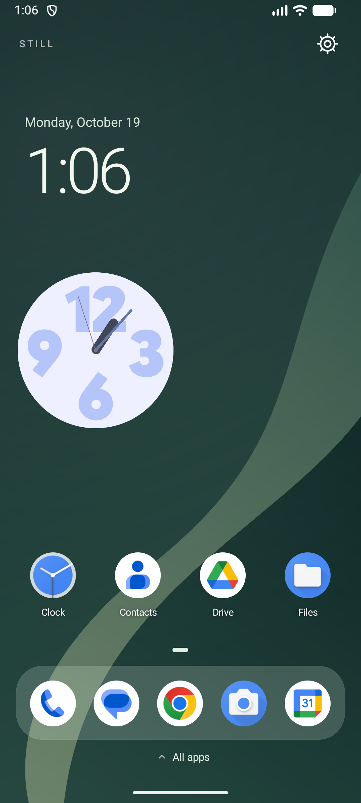
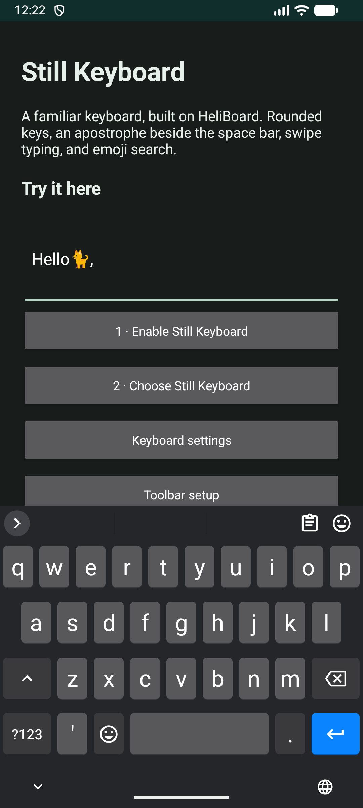
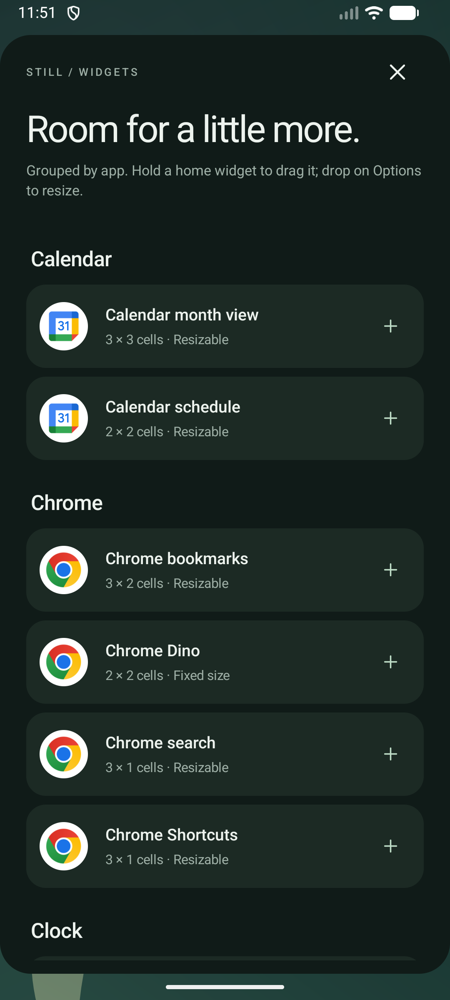

# Still Launcher

A native Kotlin Android home launcher inspired by the simplicity of Fossify. Android 8.0+; optimized for portrait phones. The launcher is an original implementation, with no Fossify source or assets copied. Still Keyboard is based on HeliBoard 3.5; see `THIRD_PARTY.md` for source and licenses.

## Download

Get the installable APK from [GitHub Releases](https://github.com/jeethsuresh/launcher/releases). GitHub automatically builds and publishes release APKs after a version bump on `main`, preserving the original preview signing certificate so installed apps update in place. See [signed Android releases](ANDROID_RELEASES.md).



## Build and run

Open this directory in Android Studio, or use a JDK 17+, Android SDK 35, and NDK 27.0.12077973:

```sh
./gradlew assembleDebug
./gradlew testDebugUnitTest lintDebug
adb install -r app/build/outputs/apk/debug/app-debug.apk
adb shell am start -n app.still.launcher/.LauncherActivity
```

On this Mac, Android Studio's bundled Java works:

```sh
export JAVA_HOME="/Applications/Android Studio.app/Contents/jbr/Contents/Home"
./gradlew assembleDebug
```

Open **Still Launcher → settings → Set as default** to choose it as your Home app. You can switch back through Android Settings → Apps → Default apps → Home app. Installing the APK does not automatically change your default.

## What's included

- Alphabetical app drawer, local app-name search, profile-badged icons, package change updates.
- Live notification dots on home, dock, drawer, and folder icons, with optional Android notification access. Work and personal profiles stay separate.
- Multiple home pages with page indicators, horizontal swipes, and automatic overflow pages.
- Drag icons and widgets onto vacant cells; drag apps into the dock. Edge-hold during a drag to move between existing pages.
- A configurable 3–7 slot dock. Shrinking the dock moves overflow apps onto the home grid.
- Native third-party widgets, including Android's bind consent and provider configuration screens.
- Widget size controls with a grid preview, collision checks, provider resize directions and minimum/maximum dimensions.
- Home grid: 3–7 columns, 4–9 rows. Drawer: 3–6 columns. Icon size, home labels, layout lock, dark/light/system appearance.
- Three original vector-drawn wallpapers, photo selection, device/live wallpaper support, and a darkness control. Home follows Android’s active wallpaper, including changes made outside Still.
- Local layout/settings persistence. No ads, accounts, analytics, or network permission.

## Controls

- Swipe up, or tap **All apps**, to open the drawer. At the top of the app list, pull down to bring the drawer down and return home. Scrolling a longer app list keeps the drawer open.
- Hold a drawer app and drag it straight onto home. Drop it on **Options** for Add to home, Pin to dock, App info, or Hide from All apps. TalkBack also exposes **App options**.
- Open **Widgets** from All apps, then hold a widget and drag it to a home cell. Android permission/configuration screens retain that location. Tapping a widget still adds it automatically.
- Open **Launcher settings → Hidden apps** to hide or restore apps. Checked apps are hidden; **Save** applies changes, **Cancel** discards edits, and **Show all** restores everything. Home and dock shortcuts stay available.
- Open **Launcher settings → Notification badges → Open Android settings** and allow **Still Launcher notification badges**. Dots indicate active notifications, follow Android badge settings, and clear when notifications are dismissed or access is revoked. Ongoing notifications and group summaries do not create dots. Notification content is never stored or sent. See [notification badges](docs/NOTIFICATION_BADGES.md).
- Hold an app or widget at a screen edge to turn pages. At the outer edge, a new page is inserted there. Move away and back to turn another page.
- Swipe horizontally between pages; the workspace follows your finger and settles with an animation. The date and dock stay fixed.
- Hold the date at the top, or empty home space, to open customization and Launcher settings.
- Hold a home icon to drag it. Drop onto **Remove** to remove its shortcut, or **Options** for its menu, including App info.
- Hold empty home space for widgets, wallpapers, page controls, and arrangement mode.
- Hold a home widget or clock to drag it directly. Drop onto **Options**, then choose **Resize** for width/height controls. Unavailable resize directions are omitted; occupied cells are rejected.
- In **Arrange home screen** mode, tap a widget or home icon for its options. TalkBack exposes **Item options** actions too. Ordinary widget buttons and scrolling work outside arrangement mode.
- An empty home page can be removed by holding its background. At least one page remains.
- Back closes panels/edit mode; Home returns to the launcher and then the first page.

## Still Keyboard

Open **Launcher settings → Still Keyboard** to enable and select the included system keyboard.
It works in other Android apps too.

- Rounded light/dark keys and an apostrophe in Android's usual comma position.
- Offline swipe typing, spelling correction, and word suggestions.
- Emoji palette with local English keyword search, plus symbols and long-press alternates.
- Hold toolbar actions or suggested words to use them; quick taps do nothing.
- Hold the left arrow for toolbar setup. Hold emoji category/search controls too.
- US/UK English dictionaries are bundled. No proprietary gesture library is required.

See `docs/KEYBOARD.md` for controls, setup, and testing, and `THIRD_PARTY.md` for licensing.

 
Widgets in the picker are grouped by app, with apps in alphabetical order.

## Structure and future additions

- `LayoutEngine.kt`: pure Kotlin placement, collision checks, and grid reflow. No Android dependencies.
- `LauncherStore.kt`: a versioned, local state boundary for settings, pages, dock order, and typed workspace items.
- `AppCatalog.kt`: profile-aware app discovery, package callbacks, bounded icon cache, background loading.
- `Widgets.kt`: stable AppWidgetHost identity, bind/configure result handling, and cancellation cleanup.
- `WorkspaceView.kt`: cell geometry, placement rendering, and home gestures.
- `WorkspacePager.kt`: finger tracking, animated page transitions, and adjacent live pages.
- `Design.kt`: shared styling, original wallpaper drawing, and line icons.
- `LauncherActivity.kt`: home/panel composition and user actions.

A future feed can be a separate panel alongside the drawer and settings, with its own repository. Weather can arrive first as a regular Android widget, then as a dedicated content module. Device-wide search should add search providers beside the catalog, leaving app discovery and workspace geometry intact. There are no fake feed or weather controls in this first version.

## Current scope

This is a functional launcher preview that preserves its original signing identity. It is not a Play Store release. Portrait phone layout and English copy are the initial focus. Icon packs, pinned app shortcuts, Android Private Space integration, backup/restore, a news feed, weather services, and device-wide search are not included. Standard accessible profiles use LauncherApps; enterprise and OEM-specific policies still need physical-device testing. Layout backup is disabled because widget IDs cannot safely be restored as ordinary preference values.

See `docs/VALIDATION.md`, `docs/KEYBOARD_VALIDATION.md`, `docs/WALLPAPER_VALIDATION.md`, `docs/HIDDEN_APPS.md`, and `docs/HOME_DRAGGING.md` for build and emulator checks.

## Platform references

- [Android widget hosting contract](https://developer.android.com/develop/ui/views/appwidgets/host)
- [AppWidgetHostView size reporting](https://developer.android.com/reference/android/appwidget/AppWidgetHostView#updateAppWidgetSize(android.os.Bundle,%20java.util.List%3Candroid.util.SizeF%3E))
- [LauncherApps](https://developer.android.com/reference/android/content/pm/LauncherApps)
- [Default Home role](https://developer.android.com/reference/android/app/role/RoleManager#ROLE_HOME)

## 0.4.0

Folders on home screens and in the dock, bottom drawer search, Hide/Uninstall drop targets below the dock, photo wallpaper previews, and independent drawer/dock colours and opacity. See [usage and persistence](docs/FOLDERS_AND_APPEARANCE.md). Distributed through the private store at https://apps.gravitas.cool/apps/launcher.
